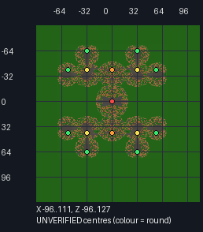

# Evolution and Gladiators original-map recovery

This is a **terrain recovery**, not a playable map import. The 28 untouched
Nixuge ZIPs live under `update/map-recovery/nixuge/unconfigured/` and are
intentionally excluded from `SourceMapCatalog` and the production plugin.
Original hashes and URLs are tracked in `provenance.json`.
The runtime also rejects any future Evolution or Gladiators source-map ZIP
that does not contain a complete game-specific `WorldConfig.dat` marker set.
This is a minimum metadata gate, **not** a replacement for terrain and human
acceptance checks.

## What we have established

- 6 Evolution and 22 Gladiators downloadable standard-map worlds are readable
  legacy Minecraft region backups (11,667 chunks in total).
- None contains `WorldConfig.dat`; none contains an emerald-ore block (`129`)
  from which the legacy Gladiators gate markers could be recovered directly.
  The latter observation does **not** prove the original maps never had gates:
  these are WorldDownloader captures of already-running worlds.
- `update/maps/Gladiators/Gladiators_Caged_In.zip` is the complete source-map
  control. Its genuine `WorldConfig.dat` has GREEN team start (1), RED final
  arena (1), ORANGE semifinals (2), YELLOW quarterfinals (4), GREEN initial
  arenas (8), BLACK duel spawns (30), and PINK stage connectors (14).
- `update/maps/One in the Quiver/Quiver_Twin Peaks 2.0.zip` has 16 GREEN
  **Quiver** starts, all 16 of which have a solid supporting block and two
  clear headroom blocks at their authored Y in the recovered original terrain.
  They are a *real, physically plausible starting-point reference*, not
  authenticated Evolution PvP placements. There is *no* Evolution
  RED/GREEN/YELLOW evolution platform data, so this cannot yet be loaded as
  an Evolution map. Matching names alone do not make the layout equivalent.

## Reproducible spatial review

From repository root:

```bash
python3 .github/scripts/audit_recovered_arcade_maps.py \
  --references \
  --json /tmp/testplex-recovered-map-audit.json \
  --images /tmp/testplex-recovered-map-preview
python3 -m unittest discover -s .github/scripts \
  -p 'test_audit_recovered_arcade_maps.py' -v
```

The JSON audit reports each downloaded ZIP's unchanged SHA-256, chunk
footprint, emerald-ore count, level spawn and WorldDownloader camera position.
The latter two positions are *not* authenticated gameplay starts. The optional
PNG previews (Pillow required) show top-down terrain, a 32-block coordinate
grid, and reference authored markers for Caged In and Quiver Twin Peaks.
They do not infer game-specific markers. All outputs stay outside playable maps.

### Gladiators Bliss: provisional bracket review

The 1.8 worlds sometimes have large **invisible barrier (ID 166) ceilings**
above their fighting arenas. A naive top-down image of those *visible to an
NBT reader but invisible to a Minecraft player* ceilings hides the stage
geometry. For a meaningful terrain review, also render below those blocks:

```bash
python3 .github/scripts/audit_recovered_arcade_maps.py \
  --game Gladiators --hide-barriers --images /tmp/gladiators-without-barrier-roofs \
  --json /tmp/gladiators-without-barrier-roofs.json
python3 .github/scripts/review_gladiators_bracket.py \
  update/map-recovery/nixuge/review/gladiators-bliss-stage-centres.json \
  --image /tmp/gladiators-bliss-inferred-stage-centres.png
```

From this view, **Bliss** has a symmetrical 15-room arena layout. The JSON
under `update/map-recovery/nixuge/review/` records 15 approximate X/Z stage
centres as explicitly `UNVERIFIED_GEOMETRY_ONLY`, keyed to the recovered
ZIP's checksum. The read-only checker follows the source 1.8
`Gladiators.parseArenas` nearest-child linking and finds one unique parent
for each room. All 15 candidate centres have a solid, two-block-clear foot
level at **Y=6**. The checker is calibrated against Caged In's authentic
15-room tier topology and **all 30** real BLACK duel spawn coordinates.



*Bliss, beneath its invisible barrier roof. The coloured circles are inferred
stage centres for review only, **not** original Mineplex markers.*

**This is not an original WorldConfig or a playable map.** An apparent
arena centre does not establish the original BLACK spawn pairs, PINK particle
points, emerald-ore gates (all missing in the WDL snapshot), or spectator
and player paths. The validator refuses candidates marked playable and never
writes to `update/maps`. Complete and human-review those remaining pieces
before adding any map to rotation.

## Required evidence before adding one map to rotation

1. Identify the exact original layout and preserve Nixuge's archive byte-for-
   byte, plus its checksum. If original Reborn `WorldConfig.dat` can be found,
   record its source and verify every marker against the terrain. If recreating
   it instead, explicitly label it **reconstructed**, with coordinates,
   screenshots and reviewer attribution; do not claim it is original data.
2. Evolution: at least 16 safe GREEN team respawn positions, and one coherent
   **RED** platform, **GREEN** viewing point and **YELLOW** return/storage
   point for evolving. The original `Evolution.ParseData` associates those
   three markers only when they are within eight blocks of one another. Keep
   the station separate from combat, verify floor and headroom, and test
   repeat deaths/evolutions with humans and bots.
3. Gladiators: one safe GREEN team start, a complete stage bracket with one
   RED, two ORANGE, four YELLOW and eight GREEN arena centres, paired BLACK
   positions for duels, the PINK progression points, and appropriate gates.
   The 1.8 `Gladiators.parseArenas` links rounds by proximity, so visually
   plausible but wrongly paired stages are not acceptable. Check every pair,
   gate, collision boundary and spectator route, including a full 16-player
   bracket and smaller lobby sizes. Do not conflate Nano Gladiators maps.
4. Supply a *separate* configured derivative archive with a full reviewed
   `WorldConfig.dat`; keep the captured ZIP in `unconfigured/` permanently for
   provenance. Check source-map bounds, Y coordinates, missing chunks, spawn
   safety and packaging before considering a new `update/maps/<Game>/` entry.
5. Run unit/integrity tests, isolated Paper 26.3 multiplayer smoke tests and
   human per-map acceptance. Only then remove the draft gate and merge/deploy.

For the original Mineplex authoring requirements, see the
[Mixed Arcade map guide](https://mineplex.com/threads/mixed-arcade.20586/).
